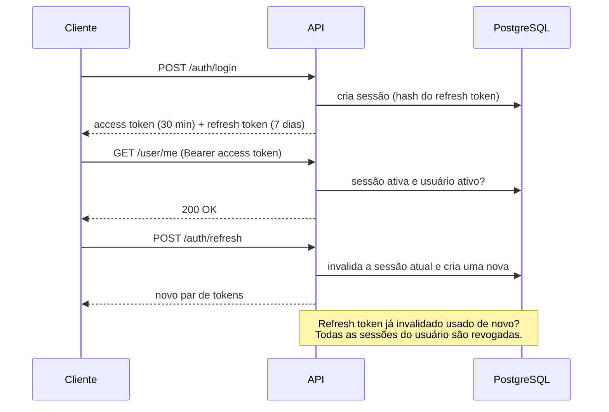

# Descrição do projeto
Projeto base para sistemas que exigem: 
- Cadastro 
- Login com e-mail/senha ou Google 
- Sessões JWT revogáveis 
- Confirmação de e-mail
- Recuperação de senha 

Tecnologias:


Este módulo foi construído com foco em **segurança**, cobrindo principais problemas que aparecem em sistemas de autenticação. O projeto pode ser utilizado como uma base para demais outros projetos.


## Backend

API REST em **Java 21 + Spring Boot 4**, responsável pelas regras de negócio e pela segurança.

### Destaques técnicos

- **JWT stateless, mas revogável.** O access token carrega o id da sessão, e a API confere esse id no banco a cada requisição. Logout, troca de senha e bloqueio de usuário passam a valer na hora, sem esperar o token expirar.
- **Rotação de refresh token com detecção de reuso.** Cada refresh invalida o token usado e emite um novo. Se um token já invalidado aparecer de novo, sinal de que pode ter vazado, todas as sessões do usuário são encerradas.
- **Nenhum segredo guardado em texto puro.** Senhas usam BCrypt. Refresh tokens e tokens de e-mail ficam salvos apenas como hash SHA-256, então um vazamento do banco não entrega sessões válidas.
- **Login social com Google.** O `idToken` é validado no servidor, conferindo assinatura e audiência, antes de criar ou autenticar o usuário.
- **Confirmação de e-mail e recuperação de senha.** Os links usam tokens aleatórios de 256 bits, de uso único, que expiram em 15 minutos. Um intervalo de 5 minutos entre envios evita spam de e-mails.
- **Controle de acesso por papéis com hierarquia.** `ADMIN` herda as permissões de `MODERATOR`, que herda as de `USER`, tudo configurado no Spring Security.
- **Respostas que não ajudam um atacante.** O login devolve a mesma mensagem para e-mail inexistente e para senha errada, e erros internos nunca expõem stack traces.
- **Schema versionado.** O banco evolui por migrations do Flyway, e o Hibernate em modo `validate` impede que a aplicação suba se as entidades não baterem com o schema.
- **Ambiente de desenvolvimento em um comando.** Ao iniciar, o Spring Boot sobe o PostgreSQL e um servidor de e-mail de testes via Docker Compose.

### Stack

| Camada          | Tecnologias                                                    |
| --------------- | -------------------------------------------------------------- |
| Linguagem       | Java 21                                                        |
| Framework       | Spring Boot 4 (Web MVC, Security, Data JPA, Validation, Mail)  |
| Autenticação    | JWT (Auth0 java-jwt), Google Sign-In, BCrypt                   |
| Banco de dados  | PostgreSQL 16, Hibernate, Flyway                               |
| Infraestrutura  | Docker, Docker Compose, Mailpit (SMTP de desenvolvimento)      |
| Build           | Maven, Lombok                                                  |

### Arquitetura

Arquitetura em camadas com responsabilidades bem separadas:

```
controllers/   → recebem a requisição e validam o payload (Bean Validation)
services/      → regras de negócio: autenticação, usuários, tokens, e-mail
repositories/  → acesso a dados com Spring Data JPA
models/        → entidades JPA
config/        → Spring Security, filtro JWT, CORS, seed do usuário admin
exceptions/    → exceções de domínio e handler global com formato de erro padronizado
schedulers/    → tarefa diária que limpa tokens expirados
```

#### Fluxo de autenticação



### Funcionalidades da API

| Área            | Endpoints                                                                                   |
| --------------- | ------------------------------------------------------------------------------------------- |
| Cadastro        | `POST /user/register` · `POST /auth/validate_user`                                          |
| Login e sessão  | `POST /auth/login` · `POST /auth/login/google` · `POST /auth/refresh` · `POST /auth/logout` · `POST /auth/revoke_login` |
| Senha           | `POST /auth/forgot_password` · `POST /auth/reset_password`                                  |
| Usuário         | `GET /user/me`                                                                              |
| Administração   | `GET /user/all` · `DELETE /user/{id}` · `POST /auth/revoke_user_session/{id}` · `POST /auth/revoke_all_sessions` |

## Frontend

SPA em **Angular 22** que consome a API e cobre todo o fluxo de conta, do cadastro à recuperação de senha.

### Destaques técnicos

- **Sessão renovada sem o usuário perceber.** Um interceptor HTTP anexa o access token a cada requisição. Se a API responder 401, ele renova os tokens e repete a requisição original.
- **Um único refresh por vez.** Requisições simultâneas que recebem 401 compartilham a mesma chamada de refresh. Sem isso, a rotação de tokens do backend trataria o segundo refresh como reuso e encerraria todas as sessões do usuário.
- **Renovação antecipada.** Um agendador renova o access token 1 minuto antes de ele expirar.
- **Tokens fora do `localStorage`.** Por enquanto, os tokens ficam só em memória, e não no `localStorage`, onde qualquer script injetado por XSS conseguiria lê-los.
- **Angular moderno.** Componentes standalone, signals, guard e interceptor funcionais e lazy loading em todas as rotas.
- **Formulários reativos tipados**, com as mesmas regras de validação do backend (como senha de 8 a 72 caracteres).
- **Login com Google** pelo Google Identity Services. O `idToken` obtido é validado pelo backend.
- **Testes unitários** das páginas com Vitest.

### Stack

| Camada          | Tecnologias                                                    |
| --------------- | -------------------------------------------------------------- |
| Framework       | Angular 22 (standalone components, signals, Router, Reactive Forms) |
| Linguagem       | TypeScript 6                                                   |
| HTTP e estado   | HttpClient, RxJS                                               |
| Autenticação    | angularx-social-login (Google Identity Services)               |
| Testes          | Vitest, jsdom                                                  |
| Qualidade       | Prettier                                                       |

### Arquitetura

```
features/          → uma pasta por tela, todas carregadas sob demanda (lazy loading)
shared/
├── services/      → comunicação com a API (auth, user) e armazenamento dos tokens
├── interceptors/  → anexa o token e renova a sessão em respostas 401
├── guards/        → bloqueia rotas privadas para quem não está logado
└── validators/    → validações de formulário compartilhadas
```

### Telas

| Rota               | Tela                                                    |
| ------------------ | ------------------------------------------------------- |
| `/login`           | Login com e-mail e senha ou com Google                  |
| `/register`        | Cadastro                                                |
| `/validate_user`   | Confirmação de e-mail (aberta pelo link enviado)        |
| `/forgot_password` | Pedido de redefinição de senha                          |
| `/reset_password`  | Definição da nova senha (aberta pelo link enviado)      |
| `/home`            | Área logada com os dados do usuário (rota protegida)    |

## Próximos passos

- [ ] **Testes automatizados no backend.** Testes unitários dos serviços e de integração com Testcontainers, cobrindo login, rotação de refresh token e revogação de sessões.
- [ ] **Testes do interceptor e do `AuthService` no frontend**, principalmente o caso de várias requisições recebendo 401 ao mesmo tempo.
- [ ] **CI com GitHub Actions**, rodando build e testes do backend e do frontend a cada pull request.
- [ ] **Sessão que sobrevive ao recarregar a página.** Guardar o refresh token em um cookie `HttpOnly`, que o JavaScript não consegue ler, para manter o usuário logado depois de um F5.
- [ ] **Rate limiting** no login e nos endpoints que enviam e-mail, contra força bruta e abuso.
- [ ] **Documentação interativa da API** com OpenAPI/Swagger (springdo-openapi).
- [ ] **Edição de perfil** e vínculo de uma conta Google a um cadastro feito por e-mail.
- [ ] **Painel administrativo no frontend**, usancdo os endpoints de administração que a API já oferece.
